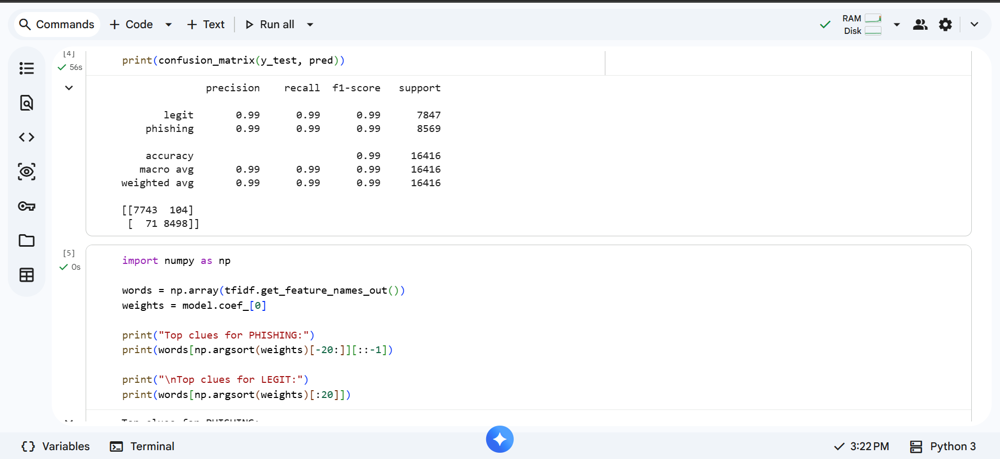
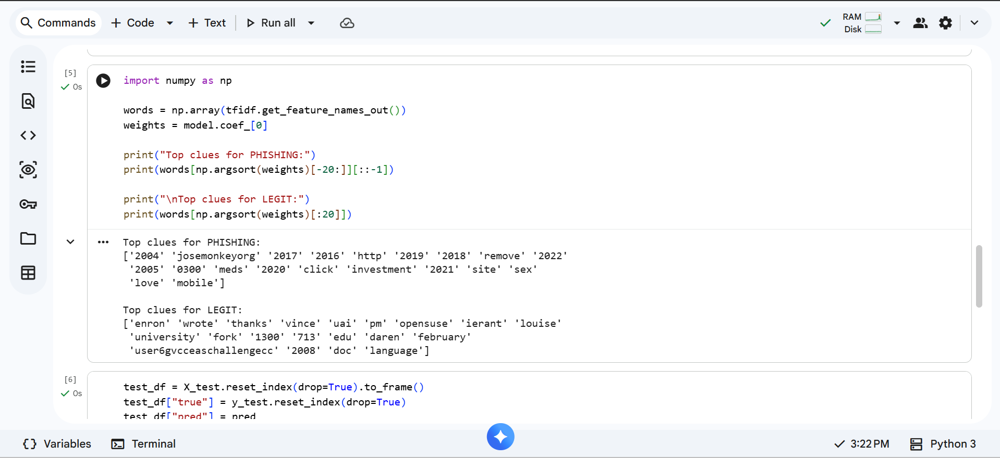
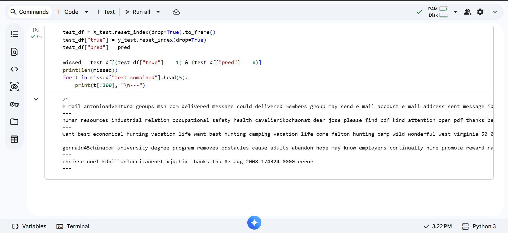
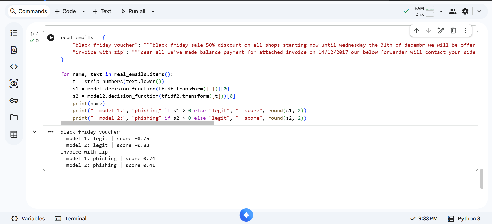

# Phishing Email Detection with an SVM

A baseline email classifier built to answer two questions: how well can a simple model separate phishing and spam from legitimate email, and how far should a headline score be trusted?

**Short answer:** about 98.9% accuracy on a held-out test set, but the score is flattered by the data, and the model misses phishing emails whose danger is not in the text.

**Author:** Faaiziat Akanni

---

## Dataset

[Phishing Email Dataset on Kaggle](https://www.kaggle.com/datasets/naserabdullahalam/phishing-email-dataset/data) (search for *"Phish No More: The Enron, Ling, CEAS, Nazario, Nigerian & SpamAssassin Datasets"*), a combination of six public email collections. The file is **not included** in this repository. Download `phishing_email.csv` from Kaggle and check the dataset page for its licence and citation requests.

| | Emails |
|---|---|
| In the file | 82,486 |
| After removing 408 duplicates | 82,078 |
| Label 0 (legitimate) | 39,233 |
| Label 1 (phishing or spam) | 42,845 |

Label 1 covers phishing **and** ordinary spam, so this project detects "unwanted or malicious email", not phishing alone.

## Method

1. Remove blank rows and duplicate emails.
2. Split 80% train and 20% test (16,416 emails), stratified, `random_state=42`.
3. Convert text to TF-IDF features: up to 20,000 words and two-word phrases, English stop words removed.
4. Train a linear SVM (`LinearSVC`) and score it on the held-out test set.

## Results

| | Normal called normal | Normal flagged as scam | Scams missed | Scams caught | Accuracy |
|---|---|---|---|---|---|
| **Model 1** (baseline) | 7,743 | 104 | 71 | 8,498 | 98.9% |
| **Model 2** (shortcuts removed) | 7,732 | 115 | 99 | 8,470 | 98.7% |

For Model 1, precision on phishing is 98.8% and recall is 99.2%.

## Checking for dataset shortcuts

The legitimate emails in this file come mostly from old corporate and mailing-list archives, and the scam emails come from other collections. A model can score well just by recognising where an email came from.

The strongest features were a clue:

- **Phishing side:** years (2004 to 2022) and the name of the person who collected one of the sources.
- **Legitimate side:** names of Enron staff, a Houston area code and software mailing-list terms.

I removed all numbers and banned those source-specific words, then retrained (Model 2). Accuracy fell only from 98.9% to 98.7%. So these giveaways were not the main reason for the high score, and the two groups differ in more than metadata. The score most likely still overstates how well the model would do on modern, real-world email.

## Error analysis

Of the 71 phishing emails Model 1 missed, the five I read were:

- an automated delivery-notice style message,
- a polite business email asking the reader to open a PDF,
- a holiday advert with no scam wording,
- a diploma-mill advert containing the word "university", one of the model's strongest "legitimate" clues,
- a short error-style message.

Most contain none of the usual scam vocabulary, so a word-based model has nothing to latch on to.

## Testing on real samples

Two phishing emails from the sample set I analysed in my [phishing email forensics project](https://github.com/Ziah19/Phishing-email-forensics-report), typed in by hand as lowercase body text (no headers, addresses or attachments):

| Email | Model 1 | Model 2 |
|---|---|---|
| Black Friday voucher | legitimate (score -0.75) | legitimate (score -0.83) |
| Invoice with a zipped attachment | phishing (score 0.74) | phishing (score 0.41) |

The voucher email reads like an ordinary shop promotion, so both models missed it. The danger in that email is the attachment, which a text-only model cannot see. The invoice email was caught, though Model 2 was much less confident after the shortcuts were removed.

Two emails is a very small test. It illustrates the failure, but it does not measure how often it happens. The email text was transcribed from screenshots, so it is close to the originals but not exact.

## Limitations

- **Text only.** The model never sees links, attachments, the sender or the email headers, which are central to real phishing detection.
- **Dataset mix.** Sources differ in era and style, and the file's text is already cleaned (lowercased, punctuation removed), so real links are mostly gone.
- **Label 1 includes spam,** not only phishing.
- **Random split.** The test set comes from the same collections as the training set. A time-based or source-based split would be a harder, more honest test.
- **Tiny real-world test.** Two hand-typed samples.
- **Not a deployed system.** Real email protection combines text with sender checks, link reputation and attachment scanning.

## Possible next steps

- Add hand-built features: number of links, whether an attachment is mentioned, urgent wording.
- Compare TF-IDF against sentence embeddings.
- Evaluate with a source-based split (train on some collections, test on another).
- Tune the decision threshold to trade false alarms against missed scams.

## Repository contents

| File | What it is |
|---|---|
| `phishing_email_detection_svm.ipynb` | The full notebook, step by step |
| `requirements.txt` | Python packages needed |
| `screenshots/` | Output screenshots from the notebook run |
| `data/` | Put `phishing_email.csv` here if running locally (not tracked by git) |

## How to run

**Google Colab:** open the notebook, upload `phishing_email.csv` through the folder panel, wait for the upload to finish, then click **Runtime > Run all**. Colab deletes uploaded files when a session ends, so upload the file again after any restart.

